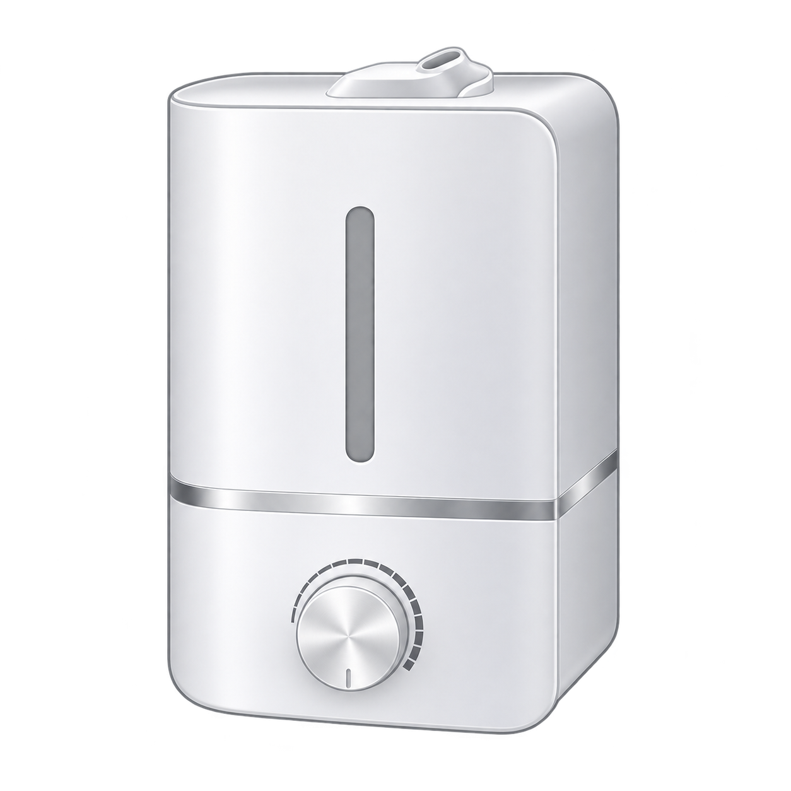

# HumidifierKit



ESP32-H2 SuperMini Zigbee controller for a humidifier. Three independent relay
outputs, an informational water-empty input, pairing button and Zigbee OTA.
Firmware: **0.2.2**, Arduino-ESP32 **3.3.7**, Zigbee router, tested with
Zigbee2MQTT **2.14.3-1**. Support currently uses the supplied external converter;
upstream/native inclusion is pending.

## Pinout

| Function | GPIO | Behaviour |
|---|---:|---|
| POWER | 10 | HIGH = on |
| BACKLIGHT / night relay | 11 | HIGH = on |
| MAX_POWER | 12 | HIGH = on, independent of POWER |
| WATER_EMPTY | 4 | Pull-up; GND = empty, open = not empty |
| Pair/reset (BOOT) | 9 | Button to GND |

GPIO numbers are not header positions. Logic is 3.3 V; use relay drivers on the
carrier board. The three outputs start OFF on reboot. Hardware pull-downs are
needed to hold active-high drivers off before firmware starts. Pin assignments
and polarity are in `firmware/HumidifierKit/board_config.h`.

Tank state never changes or blocks relays. No automatic action occurs on refill.
Inputs use 50 ms debounce. Hold BOOT 3–9 seconds and release to request joining;
hold at least 10 seconds and release to reset the Zigbee network. Factory reset
is inhibited during OTA. Holding BOOT at power-up selects the ROM bootloader.
A factory-new device automatically attempts joining. The module needs continuous
power, including when POWER is off.

## Build

Windows: PowerShell 7, Python 3.12 recommended. Run:

```powershell
./scripts/setup.ps1
./scripts/build.ps1
python scripts/test_package_ota.py
python scripts/package_ota.py
```

Setup downloads Arduino CLI 1.6.0 and the pinned ESP32 toolchain into `work/`.
The configuration is generated for the current checkout path. USB tools require
`python -m pip install esptool pyserial`. GitHub Actions also builds and packages
the firmware on Linux. Build settings: ESP32H2 Dev Module, ZCZR, 4 MB Zigbee ZCZR
partitions, USB CDC enabled. Runtime role is ROUTER, not coordinator.

For a **blank board**, flash the merged image:

```powershell
python -m esptool --chip esp32h2 --port COM3 write-flash 0 build/HumidifierKit.ino.merged.bin
```

This replaces the entire flash, including network settings. For the initial
upgrade from 0.1.0 (which boots app0), write only the app at 0x10000 to retain
pairing. After OTA, app1 may be selected: writing app0 alone does not change the
selected boot slot. Use Zigbee OTA for subsequent updates.

## Zigbee2MQTT

Copy `zigbee2mqtt/humidifierkit-h2.mjs` into `external_converters/` in the
Zigbee2MQTT data directory. Enable `advanced.enable_external_js` and restart.
Pair the device. When upgrading an existing 0.1.0 device, re-interview it once
so Zigbee2MQTT discovers the newly added OTA client on endpoint 1.

Identity: manufacturer `Orest`, model `HumidifierKit-H2`. Endpoints 1/2/3 are
power/backlight/max_power; endpoint 4 is the tank binary input.
MQTT set payload (to `zigbee2mqtt/<friendly_name>/set`):

```json
{"state_power":"ON","state_backlight":"OFF","state_max_power":"ON"}
```

`water_empty_tank` reports a boolean on changes and every 60 seconds while joined.
Home Assistant discovery exposes three switches, a binary sensor and OTA update.
The switches are labeled **Power**, **Backlight Dim** (ON dims the backlight),
and **Max Power** (ON overrides the output control knob with maximum mist output).
Home Assistant receives matching names and power/brightness/fan icons. Zigbee2MQTT
WindFront uses its built-in star icon for `state`; individual expose icons cannot
be overridden by the converter. MQTT property names remain unchanged.
For the product illustration, copy `assets/humidifierkit.png` to
`device_icons/humidifierkit.png` and set the device's `icon` option to that path.

## OTA updates

Download the `.ota` from [Releases](https://github.com/OrestHudyma/HumidifierKit/releases).
Use Zigbee2MQTT's OTA page and custom firmware upload for this device, or publish
to `zigbee2mqtt/bridge/request/device/ota_update/update`:

```json
{"id":"humidifierkit","url":"https://github.com/OrestHudyma/HumidifierKit/releases/download/v0.2.2/HumidifierKit-H2-0.2.2.ota","image_block_response_delay":50,"default_maximum_data_size":50}
```

Use **50-byte blocks**. A 64-byte block can split the extended header/subelement
boundary in a way the pinned Espressif client cannot parse. Firmware 0.2.2 caps
requests at 50 bytes. The standard 250 ms server delay is conservative; the test
uses 50 ms. Transfer time depends on the mesh. Maintain power until completion.
Relays remain independently controllable during transfer; they start OFF after
reboot. Network settings remain in their separate flash partition.

For automatic discovery, configure the following override index (merge with an
existing custom index instead of overwriting it):

```yaml
ota:
  zigbee_ota_override_index_location: https://github.com/OrestHudyma/HumidifierKit/releases/latest/download/index.json
```

Checks do not automatically install firmware. The OTA identity is development
manufacturer `0xFFF1`, image type `0x484B`, hardware 1. This is not a registered
CSA manufacturer identity. Existing app0/app1 slots are each 0x140000 bytes.

To release a new version, increment `FW_VERSION` and monotonic `FW_FILE_VERSION`
in `version.h`, build and run `scripts/package_ota.py`. Upload the resulting
`.ota` and `index.json` from `dist/` to the matching GitHub release. The packager
checks chip ID and size, and puts SHA-512 in the index. Never package the merged
flash image as OTA. The SDK validates the application before selecting its slot.
There is no signed firmware/secure boot and no automatic rollback from an app
that boots but behaves incorrectly; install only trusted firmware.

## Diagnostics

USB at 115200 baud: `status`, `join`, `power on/off`, `backlight on/off`,
`max_power on/off`. `status` includes OTA version and running partition.
`joined` is SDK network state, not a live ping. Do not open serial tools that
pulse DTR/RTS during OTA. The bundled monitor opens with both signals inactive.

```powershell
python scripts/serial_check.py COM3
python scripts/monitor.py COM3
```

The output test exercises all eight combinations and returns all outputs OFF.
Use only with a bare board or appropriate test loads. GPIO readback does not
verify relay contacts or startup transients. Physical tank/button tests, relay
hardware testing and long-duration stability remain bench work. See VALIDATION.md.
